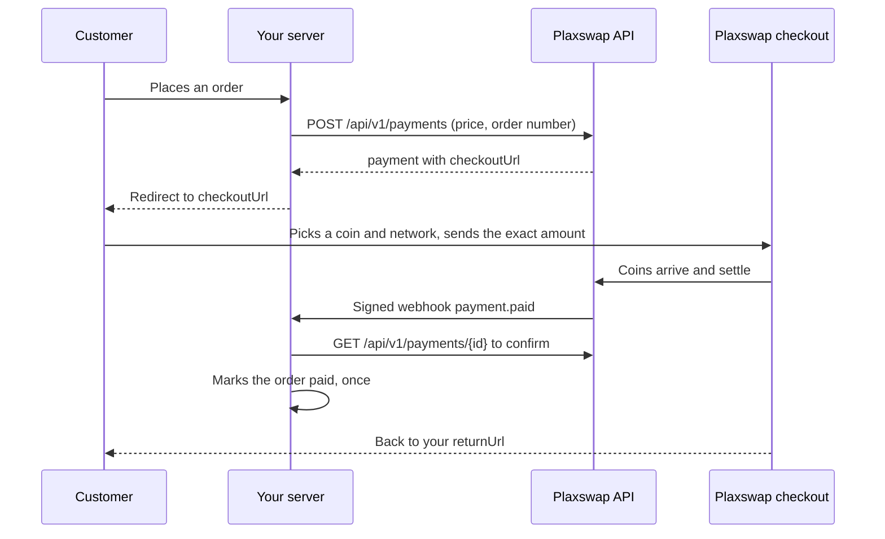

# Accept Bitcoin and crypto payments on your website

This repository shows how to add the [Plaxswap](https://plaxswap.com) crypto payment gateway to a website, shop, forum or billing system. Your customer pays in Bitcoin, USDT, Ether or another supported coin on the Plaxswap checkout, and your site is told when the payment has settled.

It has step-by-step guides, the full payment workflow, webhook checks and working code in Node.js, PHP, Python and curl.

## Choose your setup

| You have | Use | Code needed | Guide |
|---|---|---|---|
| No website, or a few invoices a month | Payment link | None | [Payment links](docs/platforms/payment-links.md) |
| A WooCommerce store | WordPress plugin | None | [WooCommerce](docs/platforms/woocommerce.md) |
| A WHMCS billing system | WHMCS module | None | [WHMCS](docs/platforms/whmcs.md) |
| A XenForo forum | XenForo add-on | None | [XenForo](docs/platforms/xenforo.md) |
| Your own website or app | Hosted checkout and API | Server code | [API integration](docs/04-api-integration.md) |

Not sure? Read [Choose your setup](docs/01-choose-your-setup.md).

## How one payment works



The full version, with every status and what to do at each one, is in [Payment workflow](docs/03-payment-workflow.md).

## Quick start for developers

1. Open a merchant account at [plaxswap.com/merchants](https://plaxswap.com/merchants). Under **Developers**, create a test API key (`pxs_test_...`), save your callback URL and make a webhook signing secret (`whsec_...`). See [Merchant account and keys](docs/02-merchant-account.md).
2. Create a payment from your server:

   ```bash
   curl -s -X POST https://plaxswap.com/api/v1/payments \
     -H "Authorization: Bearer $PLAXSWAP_API_KEY" \
     -H "Content-Type: application/json" \
     -H "Idempotency-Key: order-1042" \
     -d '{"amount":"100","currency":"USD","orderId":"1042","returnUrl":"https://shop.example/orders/1042"}'
   ```

3. Send your customer to the `checkoutUrl` in the answer.
4. Receive the webhook, check its `x-px-signature` header, then read the payment back from the API before you ship. See [Webhooks](docs/05-webhooks.md).
5. Act out paid, partly paid and expired payments in test mode, then swap in your live key. See [Testing](docs/06-testing.md) and the [go-live checklist](docs/07-go-live-checklist.md).

Ready-made servers that do all of this are in [examples](examples).

## All guides

1. [Choose your setup](docs/01-choose-your-setup.md)
2. [Merchant account and keys](docs/02-merchant-account.md)
3. [Payment workflow](docs/03-payment-workflow.md)
4. [API integration](docs/04-api-integration.md)
5. [Webhooks](docs/05-webhooks.md)
6. [Testing](docs/06-testing.md)
7. [Go-live checklist](docs/07-go-live-checklist.md)
8. [Amounts, fees and coins](docs/08-amounts-fees-coins.md)
9. [Security](docs/09-security.md)
10. [Troubleshooting](docs/10-troubleshooting.md)

Platform guides: [WooCommerce](docs/platforms/woocommerce.md), [WHMCS](docs/platforms/whmcs.md), [XenForo](docs/platforms/xenforo.md), [Payment links](docs/platforms/payment-links.md).

## Code examples

| Folder | What it is |
|---|---|
| [examples/node-express](examples/node-express) | Node.js 18+ with Express: checkout, webhook, return page |
| [examples/php](examples/php) | Plain PHP 7.4+ with cURL: the same three steps |
| [examples/python-flask](examples/python-flask) | Python 3.9+ with Flask: the same three steps |
| [examples/curl](examples/curl) | Shell scripts to create, read and simulate payments |

## Reference

- API documentation: [plaxswap.com/developers/payments](https://plaxswap.com/developers/payments)
- OpenAPI document: [plaxswap.com/api/v1/openapi.json](https://plaxswap.com/api/v1/openapi.json)
- Coins you can receive right now: [plaxswap.com/api/v1/gateway/coins](https://plaxswap.com/api/v1/gateway/coins)
- Fees: [plaxswap.com/fees](https://plaxswap.com/fees)
- Merchant terms: [plaxswap.com/legal/merchant-terms](https://plaxswap.com/legal/merchant-terms)
- Countries where checkout is closed: [plaxswap.com/help/supported-countries](https://plaxswap.com/help/supported-countries)
- Support: [plaxswap.com/support](https://plaxswap.com/support)

The live API documentation is the source of truth. If this repository and the live docs ever disagree, follow the live docs and [open an issue](../../issues).

## License

The guides and example code in this repository are under the MIT License. See [LICENSE](LICENSE).
