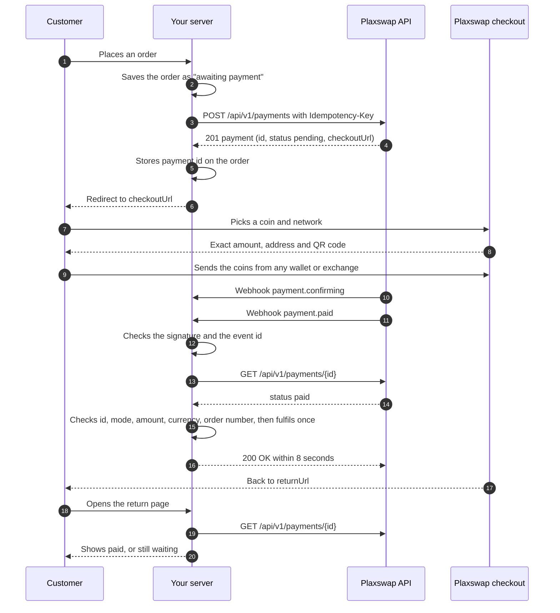
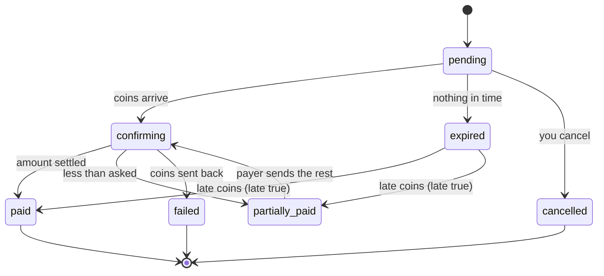

# 3. Payment workflow

This is the whole life of one payment, from the order to the money in your balance, and what your site should do at each step.

## The steps

1. Your server saves the order first, so you have something to attach the payment to.
2. It creates a payment with the price, currency and your order number. Use an `Idempotency-Key` such as `order-1042` so a retry never makes a second payment.
3. Store the returned `payment.id` on the order. This is the value you match webhooks against, never a number the customer can change.
4. Send the customer to `checkoutUrl`. They pick a coin and network and see exactly how much to send.
5. When coins arrive you get `payment.confirming`. Don't ship yet.
6. When the payment settles you get `payment.paid`. Check the signature, ignore repeated event ids, read the payment back from the API, compare it with the order, then fulfil it once.
7. The customer returns to your `returnUrl`. That page must read the payment from your server, not trust the browser.
8. The money is in your merchant balance. Withdraw it from the dashboard when you choose.

## Statuses

| Status | What it means | What your site should do |
|---|---|---|
| `pending` | Waiting for the payer. They may have picked a coin and be about to send. | Keep the order open. |
| `confirming` | Coins arrived and are being confirmed, checked or converted. | Show "payment received, confirming". Don't ship. |
| `paid` | The payer sent the amount asked and it settled. | Verify, then fulfil the order once. |
| `partially_paid` | Less than asked settled. While the payment is open the payer can send the rest. | Keep the order unpaid. Tell the customer, or review it by hand. |
| `expired` | Nothing arrived in time. | Release stock if you hold it, but don't delete the order: coins can still arrive for 24 hours. |
| `cancelled` | You cancelled it before anything arrived. | Close the order. |
| `failed` | The payer's coins were sent back to them. | Mark the order failed. |

Flags you may also see on a payment:

| Flag | Meaning |
|---|---|
| `late` | Coins arrived after the payment expired (within 24 hours). Review before you fulfil. |
| `overpaid` | Clearly more than asked arrived. The extra is yours; refunding it is up to you. |
| `underReview` | A transfer is held for a compliance check. It continues, or goes back to the payer. |

## Timing

- A payment stays open for 60 minutes by default. You can set 15 to 1,440 minutes with `expiresInMinutes`.
- Coins that arrive up to 24 hours after expiry are still passed on, marked `late`.
- Webhook deliveries that fail are retried with growing gaps, 10 times over about a day.

## Rules that keep orders safe

- Fulfil only on `paid`, never on `confirming`, never because the customer came back to your site.
- Always read the payment back with `GET /api/v1/payments/{id}` before you ship.
- Match on the `payment.id` you stored, then check `livemode`, `amount`, `currency` and `orderId`.
- Record each webhook event `id` and skip repeats. The same event can arrive twice.
- Make "mark paid" a single atomic step so two webhooks at once can't ship twice.

Next: [API integration](04-api-integration.md)
